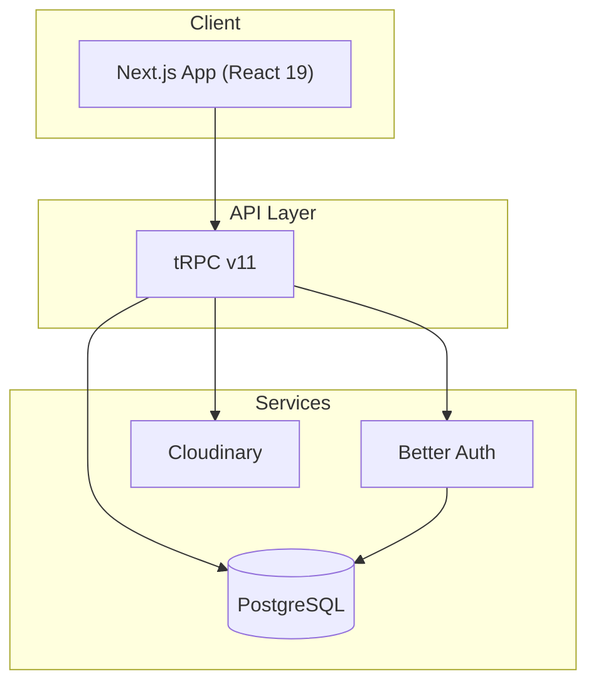
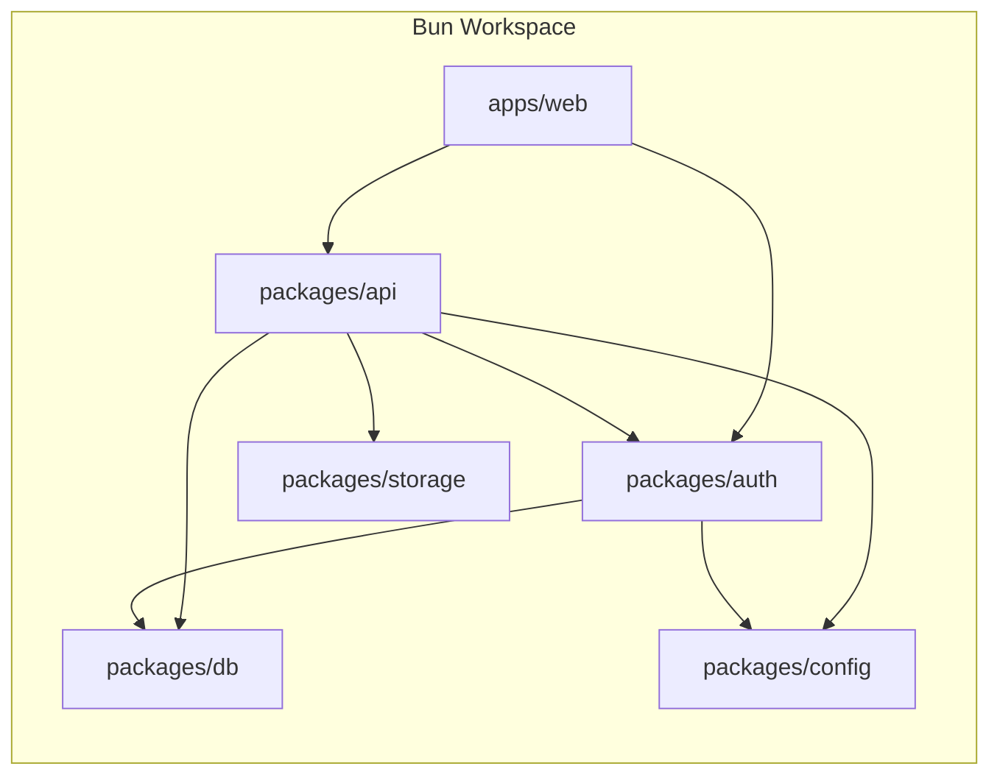
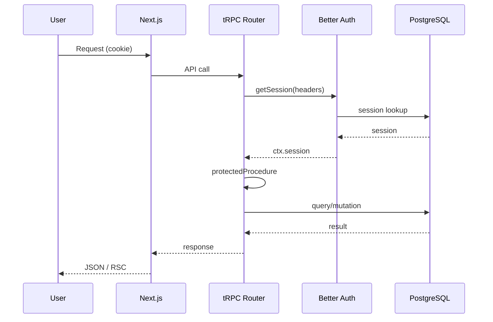
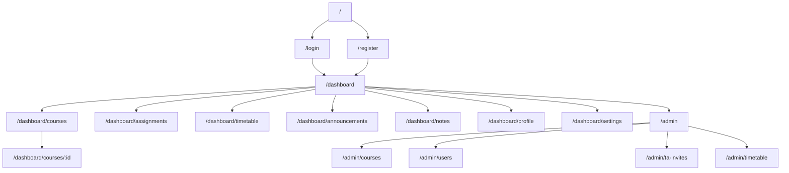
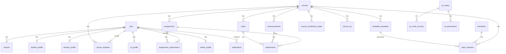

# UniTrack

**UniTrack** is a centralized academic management platform that solves **platform fragmentation** in educational environments. It brings course management, assignments, deadlines, announcements, schedules, and resources into a single dashboard for students and teachers.

---

## Table of Contents

- [Vision & Problem](#vision--problem)
- [High-Level Architecture](#high-level-architecture)
- [Features](#features)
- [Technology Stack](#technology-stack)
- [Project Structure](#project-structure)
- [Data Model](#data-model)
- [Getting Started](#getting-started)
- [Design & Development](#design--development)
- [Roadmap](#roadmap)

---

## Vision & Problem

Students often miss deadlines and announcements because information is scattered across:

- **Google Classroom** (assignments)
- **Google Forms** (deadlines)
- **WhatsApp** (announcements)
- **Verbal instructions** and inconsistent timetable updates

UniTrack provides **one place** for all course-related information: assignments, deadlines, announcements, schedules, notes, and class activity—reducing missed deadlines and improving accountability.

**Target users:** Students (primary), Teachers / TAs, Admins (optional).

---

## High-Level Architecture

### System Overview



### Monorepo Layout



### Request Flow (Authenticated)



### Application Routes



---

## Features

### Student

| Feature | Description |
|--------|-------------|
| **Unified Dashboard** | Upcoming deadlines, today's classes, recent announcements, missed tasks summary |
| **My Courses** | Enrolled courses; join via enrollment code; per-course overview with task progress |
| **Assignments** | View by status (Upcoming, Due Today, Overdue); track Not Started / Submitted / Missed |
| **Timetable** | Weekly view; class sessions (regular, extra, compensatory); cancellations and history |
| **Announcements** | Course announcements with priority (Normal / Important) and timestamps |
| **Notes & Resources** | Course notes by type (PDF, Slides, Lab Manual, etc.) and week |
| **Profile & Settings** | Profile and app settings |
| **Notifications** | In-app notifications (assignment, announcement, timetable, etc.) |

### Teacher / TA

- Create and manage courses (admin-created; TAs via invites)
- Add assignments (title, description, deadline, type: Lab, Quiz, Assignment, Project, Presentation)
- Post announcements and notes; attach files or links (Cloudinary)
- Update class status: conducted, cancelled, compensatory/extra classes
- TA invites (admin-created) for course-specific access

### Admin

- **Admin Overview** dashboard
- **Manage Courses** (create, archive); **Enrollment Codes** (generate, max uses, expiry)
- **Manage Users** (list, roles, profiles)
- **TA Invites** (create invites with course assignment, expiry)
- **Timetable Schedule** (semesters, templates, class sessions, exceptions, extra classes, academic events)

---

## Technology Stack

| Layer | Technology |
|-------|------------|
| **Runtime** | [Bun](https://bun.sh/) (v1.3.4+) |
| **Framework** | [Next.js 16](https://nextjs.org/) (App Router) |
| **Language** | [TypeScript](https://www.typescriptlang.org/) |
| **UI** | [React 19](https://react.dev/), [Tailwind CSS v4](https://tailwindcss.com/), [Radix UI](https://www.radix-ui.com/), [Shadcn UI](https://ui.shadcn.com/), [Lucide](https://lucide.dev/), [Framer Motion](https://www.framer.com/motion/) |
| **API** | [tRPC v11](https://trpc.io/) (end-to-end type-safe) |
| **Database** | [PostgreSQL](https://www.postgresql.org/) + [Drizzle ORM](https://orm.drizzle.team/) |
| **Auth** | [Better Auth](https://www.better-auth.com/) (email/password, session, role) |
| **Storage** | [Cloudinary](https://cloudinary.com/) (via `@uni-track/storage`) |
| **Validation** | [Zod](https://zod.dev/) |
| **State / URL** | [nuqs](https://nuqs.47ng.com/) (search params) |

---

## Project Structure

```
.
├── apps/
│   └── web/                 # Next.js frontend
│       ├── src/
│       │   ├── app/         # App Router (auth, dashboard, admin)
│       │   ├── components/  # UI, dashboard, courses, timetable, etc.
│       │   ├── lib/         # auth-client, navigation, utils
│       │   ├── hooks/
│       │   └── trpc/        # tRPC React provider, server caller
│       └── package.json
├── packages/
│   ├── api/                 # tRPC routers and procedures
│   │   └── src/
│   │       ├── routers/    # auth, dashboard, courses, assignments, etc.
│   │       ├── trpc.ts      # context, procedures (public/protected)
│   │       └── root.ts      # appRouter
│   ├── auth/                # Better Auth config (Drizzle adapter)
│   ├── config/              # Shared env (env.ts with Zod)
│   ├── db/                  # Drizzle schema, migrations, seed
│   │   └── src/schema/      # auth, courses, assignments, timetable, etc.
│   └── storage/             # Cloudinary integration
├── package.json             # Workspace root, scripts
└── UniTrack PRD.md          # Product requirements
```

---

## Data Model



**Core entities:** `user`, `session`, `courses`, `course_students`, `course_enrollment_codes`, `assignments`, `assignment_submissions`, `announcements`, `notes`, `attachments`, `semesters`, `timetable_templates`, `class_sessions`, `class_exceptions`, `extra_classes`, `academic_events`, `notifications`, `ta_invites`, `course_tas`, role-specific profiles.

---

## Getting Started

### Prerequisites

- [Bun](https://bun.sh/) v1.3.4 or later  
- PostgreSQL database

### Installation

1. **Clone and install**

   ```bash
   git clone https://github.com/yourusername/uni-track.git
   cd uni-track
   bun install
   ```

2. **Environment variables**

   Copy `apps/web/.env.example` to `apps/web/.env` (and `packages/db/.env` if you run db commands from there). Required (see also `packages/config/env.ts`):

   | Variable | Description |
   |----------|-------------|
   | `DATABASE_URL` | PostgreSQL connection string |
   | `BETTER_AUTH_SECRET` | Secret for auth (required in production) |
   | `BETTER_AUTH_URL` | App URL (e.g. `http://localhost:3000`) |
   | `CORS_ORIGIN` | Allowed origin (e.g. `http://localhost:3000`) |
   | `CLOUDINARY_CLOUD_NAME` | Cloudinary cloud name |
   | `CLOUDINARY_API_KEY` | Cloudinary API key |
   | `CLOUDINARY_API_SECRET` | Cloudinary API secret |

3. **Database**

   ```bash
   bun run db:push
   ```

   Optional: seed admin user (see `packages/db/src/seed-admin.ts`), open Drizzle Studio with `bun run db:studio`.

4. **Run**

   ```bash
   bun run dev
   ```

   App: `http://localhost:3000`.  
   Landing: `/` → Login/Register → `/dashboard` (student) or `/admin` (admin).

### Scripts

| Script | Description |
|--------|-------------|
| `bun run dev` | Run all workspaces in dev mode |
| `bun run dev:web` | Run only web app |
| `bun run build` | Build all packages |
| `bun run db:push` | Push schema to DB (Drizzle) |
| `bun run db:generate` | Generate migrations |
| `bun run db:migrate` | Run migrations |
| `bun run db:studio` | Open Drizzle Studio |
| `bun run check-types` | Type-check all packages |

---

## Design & Development

UI/UX was designed in **Figma**. The **Figma MCP Server** and **Antigravity** (Google DeepMind) were used to translate designs into responsive React components.

---

## Roadmap

- **Phase 1 (MVP):** Auth, courses & enrollment, assignments & deadlines, announcements, timetable, student dashboard ✅  
- **Phase 2:** Notifications (email + in-app), notes management, teacher analytics  
- **Phase 3:** Assignment submission & grading, admin dashboard refinements  
- **Future:** Calendar sync, WhatsApp/Telegram bot, AI reminders, cross-semester history  

See **UniTrack PRD.md** for full product requirements, success metrics, and out-of-scope items.
